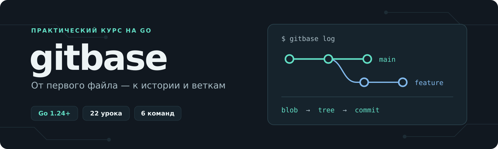

<p align="center">
  
</p>

<h1 align="center">Git на Go: пишем свою систему контроля версий</h1>

<p align="center">
  Один проект от первого CLI до коммитов, истории и переключения веток.<br>
  <strong>Только Go и стандартная библиотека.</strong>
</p>

<p align="center">
  <a href="#course">Программа курса</a> ·
  <a href="#setup">Подготовка</a> ·
  <a href="#demo">Запустить gitbase</a> ·
  <a href="EXERCISES.md">Задания</a>
</p>

---

## От содержимого файла до собственной истории

Учебный видеокурс, в котором мы с нуля создаём **gitbase** — систему контроля версий на Go. Шаг за шагом реализуем шесть команд: `init`, `add`, `commit`, `log`, `branch` и `checkout`.

Разберёмся, как содержимое файла превращается в объект с хешем, как из файлов складывается снимок проекта, как коммиты образуют историю и почему для создания ветки достаточно сохранить ссылку на коммит.

| На практике                                  | Под капотом                                            | В результате                                     |
| :------------------------------------------- | :----------------------------------------------------- | :----------------------------------------------- |
| **Пишем CLI**<br>Аргументы, команды и ошибки | **Разбираемся с данными**<br>SHA-256, объекты и снимки | **Сохраняем версии**<br>Коммиты, история и ветки |

> **Начните с [введения](1.Введение/README.md).** Обзор проекта и его ограничений также есть в [презентации курса](1.Введение/gitbase-course-introduction.pdf).

## Для кого этот курс

Для тех, кто уже знаком с основами Go и хочет применить их в небольшом законченном проекте. Пригодится понимание функций, структур, срезов, map и обработки ошибок, а также базовый опыт работы в терминале.

Курс поможет связать привычные команды Git с данными, которые стоят за ними: содержимым файлов, index, снимками, коммитами и ссылками веток.

## Что будем разрабатывать

| Команда                         | Что делает                                                                                                                        |
| ------------------------------- | --------------------------------------------------------------------------------------------------------------------------------- |
| `gitbase init`                  | Создаёт служебный каталог `.gitbase`, начальную ветку `main`, HEAD и пустой index. Повторный вызов сохраняет существующие данные. |
| `gitbase add <файл> [файл…]`    | Сохраняет содержимое выбранных файлов и добавляет их версии в index. Повторное добавление пути обновляет его запись.              |
| `gitbase commit -m "сообщение"` | Создаёт полный снимок отслеживаемых файлов, сохраняет коммит, обновляет текущую ветку и очищает index.                            |
| `gitbase log`                   | Показывает короткий хеш, дату и сообщение каждого коммита от нового к старому.                                                    |
| `gitbase branch [имя]`          | Без аргументов показывает имя текущей ветки; с именем создаёт ветку на текущем коммите без переключения.                          |
| `gitbase checkout <ветка>`      | Восстанавливает файлы из снимка выбранной ветки и переключает HEAD после успешного восстановления.                                |

В процессе поработаем с файловой системой, SHA-256, JSON, аргументами командной строки и ошибками. Начнём с `main.go`, затем выделим обработчики команд, `Repository`, `ObjectStore` и модели данных.

> **Учебный формат.** gitbase использует собственный формат хранения, несовместимый с Git. Проект помогает изучить основные идеи системы контроля версий.

<a id="setup"></a>

## Подготовка

Понадобятся:

- **Go 1.24 или новее**.
- **GNU Make**, доступный как `make`, для работы с Makefile из курса.
- Редактор кода и терминал.

Проверьте окружение:

```powershell
go version
make --version
```

У CLI нет сторонних зависимостей. Написание тестов в курс не входит: результат проверяем сборкой, запуском команд и просмотром сохранённых данных.

## Как проходить курс

1. Начните с введения и двигайтесь по урокам в порядке таблицы ниже.
2. Пишите код в одной собственной рабочей папке. Каталоги уроков содержат полные снимки проекта на конец соответствующего шага — используйте их для сверки.
3. Собирайте текущую версию из каталога с её `go.mod`. Каждый снимок — отдельный Go-модуль; в корне курса общего модуля нет.
4. Запускайте собранную программу из отдельного каталога `demo`. С урока 3 сохраняйте его `.gitbase` между занятиями: новая версия программы продолжает работать с прежними данными.

Практика после видео продолжает тот же проект и не требует новых зависимостей или написания тестов.

<a id="course"></a>

## Программа курса

**22 урока · последовательная разработка одного проекта**

В каждой строке — ссылка на материалы урока и результат очередного шага.

| №   | Урок                                                                        | Результат                                                                |
| --- | --------------------------------------------------------------------------- | ------------------------------------------------------------------------ |
| 1   | [Первая команда gitbase](<1. Первая команда gitbase>)                       | Создаём Go-модуль и разбираем первый вызов CLI.                          |
| 2   | [Инициализируем репозиторий](<2. Инициализируем репозиторий>)               | Создаём `.gitbase`, HEAD, ссылку main и index; проверяем повторный init. |
| 3   | [Вычисляем хеш и сохраняем blob](<3. Вычисляем хеш и сохраняем blob>)       | Сохраняем содержимое как объект с идентификатором SHA-256.               |
| 4   | [Читаем и сохраняем index](<4. Читаем и сохраняем index>)                   | Описываем записи index, читаем и сохраняем их в JSON.                    |
| 5   | [Проверяем пути добавляемых файлов](<5. Проверяем пути добавляемых файлов>) | Проверяем пути и отклоняем служебные файлы и каталоги.                   |
| 6   | [Собираем команду add](<6. Собираем команду add>)                           | Связываем сохранение blob с обновлением index.                           |
| 7   | [Выносим команды из main](<7. Выносим команды из main>)                     | Вводим Runner и реестр обработчиков команд.                              |
| 8   | [Выделяем Repository](<8. Выделяем Repository>)                             | Переносим инициализацию и поиск репозитория в отдельный слой.            |
| 9   | [Переносим index в Repository](<9. Переносим index в Repository>)           | Передаём Repository работу с index и путями файлов.                      |
| 10  | [Создаём ObjectStore](<10. Создаём ObjectStore>)                            | Выделяем хранилище объектов и операцию Put.                              |
| 12  | [Читаем объекты из хранилища](<12. Читаем объекты из хранилища>)            | Добавляем Get с проверкой хеша и типа объекта.                           |
| 13  | [Читаем HEAD и ссылки веток](<13. Читаем HEAD и ссылки веток>)              | Определяем текущую ветку и работаем со ссылкой на её коммит.             |
| 14  | [Описываем снимок Tree](<14. Описываем снимок Tree>)                        | Описываем и сохраняем отсортированный снимок файлов.                     |
| 15  | [Описываем объект Commit](<15. Описываем объект Commit>)                    | Готовим модель коммита, чтение, запись, время и разбор сообщения.        |
| 16  | [Сохраняем неизменённые файлы](<16. Сохраняем неизменённые файлы>)          | Объединяем снимок родителя с изменениями из index.                       |
| 17  | [Собираем команду commit](<17. Собираем команду commit>)                    | Подключаем сохранение коммита и обновление текущей ветки.                |
| 18  | [Показываем историю через log](<18. Показываем историю через log>)          | Проходим цепочку родительских коммитов и выводим историю.                |
| 19  | [Создаём ветки](<19. Создаём ветки>)                                        | Показываем текущую ветку и создаём новые ссылки.                         |
| 20  | [Готовим восстановление снимка](<20. Готовим восстановление снимка>)        | Читаем снимок выбранной ветки и проверяем пути перед восстановлением.    |
| 21  | [Завершаем checkout](<21. Завершаем checkout>)                              | Восстанавливаем файлы и переключаем HEAD.                                |
| 22  | [Финальная демонстрация](<22. Финальная демонстрация>)                      | Проходим полный цикл и проверяем независимую историю веток.              |

<p align="right"><a href="#setup">Подготовить окружение ↑</a></p>

<a id="demo"></a>

## Попробовать готовую версию

Чтобы посмотреть результат до начала курса, соберите финальный снимок. Пример ниже рассчитан на **PowerShell в Windows**; начальный каталог — корень этого репозитория.

Для демонстрации используйте новый пустой `demo-final`: учебный checkout перезаписывает файлы без защиты несохранённых изменений.

**1. Соберите программу и создайте каталог для демонстрации.**

```powershell
Set-Location -LiteralPath '.\22. Финальная демонстрация'
go build -o '..\gitbase.exe' ./cmd/gitbase
Set-Location -LiteralPath '..'
New-Item -ItemType Directory -Path 'demo-final' | Out-Null
Set-Location -LiteralPath '.\demo-final'
```

**2. Сохраните первую версию проекта.**

```powershell
..\gitbase.exe init
Set-Content -LiteralPath 'README.md' -Value 'Первая версия проекта' -Encoding utf8
..\gitbase.exe add README.md
..\gitbase.exe commit -m "Первый коммит"
```

**3. Создайте ветку и запишите в ней изменения.**

```powershell
..\gitbase.exe branch feature
..\gitbase.exe checkout feature
Set-Content -LiteralPath 'README.md' -Value 'Изменения в feature' -Encoding utf8
..\gitbase.exe add README.md
..\gitbase.exe commit -m "Изменения в feature"
..\gitbase.exe log
```

**4. Вернитесь на main и проверьте сохранённую версию.**

```powershell
..\gitbase.exe checkout main
Get-Content -LiteralPath 'README.md'
..\gitbase.exe branch
..\gitbase.exe log
```

> **Ожидаемый результат:** файл снова содержит `Первая версия проекта`, команда `branch` выводит `main`, а история main содержит только первый коммит. Коммит с изменениями остаётся в feature.

Полный сценарий с двумя коммитами в main и отдельным коммитом в feature приведён в [финальном уроке](<22. Финальная демонстрация/README.md>).

<details>
<summary><strong>Сборка и запуск через Makefile</strong></summary>

При прохождении курса можно использовать [Makefile из урока 2](<2. Первая команда gitbase/Makefile>). Сохраните его в своей рабочей папке с `go.mod`:

```powershell
make build
make run ARGS="init"
make vet
```

Makefile поддерживает Windows, Linux и macOS. Он собирает программу в родительский каталог и запускает её из соседнего `demo`, сохраняя данные между запусками. Используйте в `ARGS` команды, уже подключённые на вашем этапе курса.

</details>

## Как устроены данные

После инициализации gitbase хранит служебные данные в рабочем каталоге проекта:

```text
.gitbase/
├── objects/          # Содержимое файлов, снимки и коммиты
├── refs/
│   └── heads/
│       └── main      # Хеш последнего коммита ветки
├── HEAD              # Ссылка на текущую ветку
└── index             # Версии файлов, выбранные для следующего коммита
```

- **Blob** хранит содержимое файла. Идентификатор объекта — SHA-256 от типа, перевода строки и данных. Одинаковый payload даёт одинаковый хеш; существующий объект повторно не записывается.
- **Index** связывает путь файла с хешем выбранного blob. Повторный `add` обновляет эту связь.
- **Tree** описывает полный снимок отслеживаемых файлов. При новом коммите неизменённые пути сохраняются из снимка родителя.
- **Commit** связывает tree с родительским коммитом, сообщением и временем.
- **Ветка** хранит ссылку на коммит, а **HEAD** указывает, какая ветка выбрана сейчас.

## Ограничения учебной версии

В курсе реализуем базовый локальный цикл работы с версиями. У gitbase есть намеренные упрощения:

- Собственный формат хранения и упрощённый index; совместимости с Git и сжатия объектов нет.
- Нет удалённых репозиториев и команд `remote`, `fetch`, `pull`, `push`.
- Нет `diff`, `merge` и разрешения конфликтов.
- `add` принимает явно указанные файлы, без рекурсивного обхода каталогов.
- Нет команды удаления отслеживаемого файла из снимка.
- `checkout` перезаписывает файлы без защиты незакоммиченных изменений и оставляет файлы, отсутствующие в целевом tree.
- Не поддерживаются симлинки, сохранение прав доступа и платформенных особенностей файлов.
